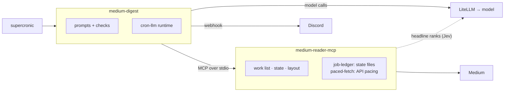

<div align="center">

# Medium Digest

**A daily Medium digest: shortlisted from the headlines, read in full, the best starred, posted to Discord.**


[How it fits together](#how-it-fits-together) · [What the model is asked](#what-the-model-is-asked) · [How a run goes](#how-a-run-goes) · [Running it](#running-it) · [Configuration](#configuration) · [Development](#development)

</div>

A daily Medium digest posted to a Discord channel: new posts from the authors and publications you follow, Medium's top picks, and your "For you" recommendations. A model shortlists from the headlines, reads each shortlisted post in full, and stars the few worth reading in full.

It's a plain scheduled job, not an agent:

- [medium-reader-mcp](https://github.com/wkbaran/medium-reader-mcp) runs as a child process. Its digest tools fetch the three feeds, drop posts already reported, rank the headlines against your `interests.md` (with its classifier), lay out the message and keep the state.
- [cron-llm](https://github.com/wkbaran/cron-llm) calls any OpenAI-compatible gateway with a JSON schema per question, and posts to the Discord webhook.
- The model answers three kinds of narrow questions: which headlines to read, what each post argues (type, gist, depth 1–5, why), and which posts to star. The code checks every answer: refs must exist in the right section, at most 10 Following (3 per publication), 5 top picks and 10 For you, and at most the server's ⭐ limit (8). All of these are settings.

## How it fits together



The job holds only the prompts and the checks on each answer. [cron-llm](https://github.com/wkbaran/cron-llm) gives it the model calls, the MCP client and the Discord post. The MCP server owns everything with consequences: the API, the state and the message layout, on [job-ledger](https://github.com/wkbaran/job-ledger) for state and [paced-fetch](https://github.com/wkbaran/paced-fetch) for API pacing. The model never touches state or the API directly. The other jobs ([substack-digest](https://github.com/wkbaran/substack-digest), [spotify-discovery](https://github.com/wkbaran/spotify-discovery)) have the same shape with a different server.

## What the model is asked

The model never sees the whole day at once. It answers three kinds of narrow question, each with a JSON schema, and every answer is checked by code. The questions are written to get past the usual failure of digest summaries: a sentence about what a post is *about*, which tells you nothing about whether to read it.

**The shortlist, from headlines alone.** The model gets each section's candidates (Following `F`, Medium's Top picks `T`, For you `Y`) as rows: title, author and publication, reading time, claps, member-only, whether the reader read that author recently, why Medium showed it, and the classifier's rank when it's on (rows are sorted by it, since the rank already reflects the reader's interests and skips). Along with the reader's `interests.md` and recent reading, it chooses which posts get read in full:

- up to a set number per section, at most a few from one publication; pass over near-duplicate headlines;
- prefer authors the reader read recently, and For you posts shown because of reading history;
- **fewer, or none, when a section is weak**: don't pad;
- separately, list clear clickbait the classifier missed (income claims, listicle bait, rage bait).

**One question per shortlisted post**, with the post's full text. The model is told to judge only from the text, never from the title.

| Field | What it means |
|---|---|
| `type` | essay, reporting, analysis, tutorial, listicle, opinion, announcement or other |
| `gist` | **The post's actual argument or findings, not its topic**, in 1–2 sentences. It leads with the claim ("Moving the cache to the edge halved p99 latency, because…"), never "This post discusses…" or "The author argues…". For a listicle, only its strongest item. It's written before the model knows whether the post will be starred, so it's held to the shorter of the section-line and star limits (`MEDIUM_READER_DIGEST_GIST_MAX`, `_STAR_GIST_MAX`), stated as characters and approximate words |
| `depth` | 1–5: **how much you lose by reading only the gist.** 5 is dense original thinking or evidence that doesn't compress; 1 means the gist covers it |
| `why` | One sentence justifying the depth, naming what's distinctive |

The reader's interests are shown as context, with the instruction to describe the post as it is.

**One question for the ⭐ picks**, over the verdicts: start from depth 4–5, rank up interests and authors the reader reads, rank down listicles, announcements and preview-only posts, usually 3–6 and **none rather than padding**. Each pick gets one sentence on why it's worth reading in full, naming what's distinctive rather than repeating the gist.

The code then checks every answer: refs must exist in the right section, caps hold, and refs the model invents are dropped and logged. An answer that doesn't fit its schema costs that one post its gist, not the run.

## How a run goes

1. `digest_begin` returns the work list as data: every post with its section, rank, flags and Medium's reason, plus your interests and reading history.
2. One call shortlists from the headlines. If its answer is unusable, the best-ranked posts are taken.
3. Each shortlisted post is read with `read_post` (paged up to `MAX_POST_CHARS`) and judged.
4. One call stars the best. If its answer is unusable, the stars fall back to depth 4–5.
5. `digest_finish` saves state and returns the message, which goes to Discord. `[SILENT]` posts nothing.

An answer that doesn't fit its schema costs that step its judgment, not the run. A gateway error or a server crash ends the run with a failure notice, and the next run covers the same period, since state is saved only by `digest_finish`.

## Running it

```sh
npm install
npm run build
cp docker/.env.example .env                    # fill in; the host directories are only for the container
node --env-file=.env dist/main.js --dry-run    # prints the message; digest_finish saves nothing
```

Sign in to Medium once on a machine with a browser (`npx medium-reader-mcp login`), and point `MEDIUM_READER_HOME` at the directory holding `auth.json`.

### In a container

`docker/` has a Dockerfile, a crontab for [supercronic](https://github.com/aptible/supercronic) (06:15 in the container's `TZ`) and a compose file. Copy `docker/.env.example` to `docker/.env`, set the host directories and the rest, then:

```sh
docker compose -f docker/compose.yaml up -d --build
docker exec medium-digest node /app/dist/main.js --dry-run   # try it now
docker logs medium-digest                                     # one line per step and per model call
```

The container runs as uid 1000; the state and auth directories should belong to it.

## Configuration

| Variable | |
|---|---|
| `LLM_BASE_URL`, `LLM_API_KEY`, `LLM_MODEL`, `LLM_REASONING_EFFORT` | The gateway and model (see cron-llm). Requests are tagged `job:medium-digest`, `run:<run id>` and `step:shortlist` / `step:post` / `step:picks` for the gateway's logs |
| `DISCORD_WEBHOOK_URL` | Where the digest goes. Without it, the message is printed |
| `DISCORD_FAILURE_WEBHOOK_URL` | Where failure notices go; defaults to the digest webhook |
| `MEDIUM_READER_*`, `TZ` | Passed to medium-reader-mcp, and nothing else from the job's environment is. `MEDIUM_READER_DIGEST_DIR` defaults to `/data` and `MEDIUM_READER_HOME` to `/auth`. The server's default classifier, `sampling`, needs an agent host, so set `MEDIUM_READER_CLASSIFIER=jev` (or `off`). See its README for the rest |
| `MEDIUM_REAUTH_HINT` | What to do when the session expires; it's sent in place of the digest |
| `MEDIUM_READER_DIGEST_GIST_MAX`, `_STAR_GIST_MAX`, `_WHY_MAX`, `_MAX_STARRED` | The server's limits. `digest_begin` returns them, and the job writes the same numbers into its prompts and schemas, so the model is asked for what the server keeps. Set them here, not in the prompts |
| `SHORTLIST_FOLLOWING`, `SHORTLIST_TOP_PICKS`, `SHORTLIST_FOR_YOU`, `SHORTLIST_PER_PUBLICATION` | How many headlines may be shortlisted from each section, and from one publication in Following (default 10, 5, 10, 3), also stated in the shortlist prompt |
| `MAX_POST_CHARS` | How much of one post the model reads (default 60000) |
| `JOB_DRY_RUN=1` | Same as `--dry-run` |

## Development

```sh
npm test
```

Node 26 or later. MIT licensed.
